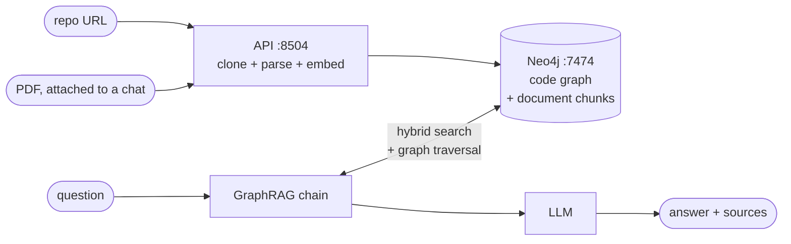
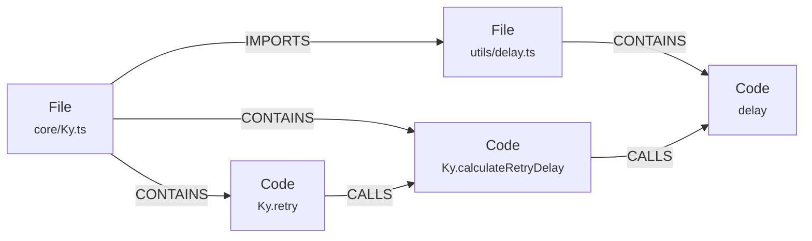

# Code graph RAG

Point it at a TypeScript/JavaScript repository and ask questions about it.

The repo is parsed into a **knowledge graph** in Neo4j — every function, method,
class and type is a node, with edges for what calls what and which files import
which. Answering a question searches that graph *and walks its relationships*,
so the model sees the code you asked about **plus the code around it**.

Attach a PDF to a chat and it is read alongside the code, which is what you want
when the answer is half in a spec and half in the implementation.

---

## How it works



### The graph

Every symbol is its own node keyed by `path:line:qualified_name`, so a name that
repeats across the repo never collapses into one shared node.



### Retrieval

Vector search finds an entry point. The graph supplies the context around it —
that traversal is what makes this GraphRAG rather than vector search that
happens to be stored in a graph.


Full-text sits alongside vectors because code questions often name a symbol
exactly, which lexical matching handles better than embeddings.

When the chat has PDFs attached, their chunks are retrieved in the same pass and
share that budget rather than adding to it — `k` drops from 4 symbols to 2, plus
4 excerpts, which is about the same amount of context either way.

---

## Quick start

**1.** Copy `env.example` to `.env`. The defaults work; the one choice that
matters is the model.

**2.** Start it:

```bash
docker compose up
```

Answering questions needs an LLM. On Linux, run one in a container:

```bash
docker compose --profile linux up
```

...with `OLLAMA_BASE_URL=http://llm:11434` in `.env`. Add `COMPOSE_PROFILES=linux`
there too and a plain `docker compose up` starts it; leave it out and the
hostname `llm` does not resolve on any run where you forget the flag. Or set
`LLM=gpt-3.5` plus an `OPENAI_API_KEY` and nothing is downloaded. Without
either, indexing still works and questions report a clear error.

**3.** Open **http://localhost:5173**, paste a repository URL on *Index a
repository*, and press the button. Then ask questions on *Ask the codebase* —
and use the paperclip there if a PDF belongs in the conversation too.

The importer is idempotent — re-indexing updates nodes in place.

---

## Conversations

Chats are saved in Neo4j, not in the browser, so they survive a refresh and a
`docker compose down`. **New chat** in the sidebar starts one, the list switches
between them, and each can be renamed or deleted. A chat is titled after its
first question.

```
(:Conversation {id, title})-[:HAS_MESSAGE]->(:Message {role, content, position})
(:Conversation)-[:USES_DOCUMENT]->(:PdfDocument {id, name, pages, chunks})
```

Messages carry an explicit `position` rather than being ordered by timestamp —
both halves of a turn are written milliseconds apart.

These labels sit outside the code graph on purpose: clearing the index from
*Danger zone* deletes `File`, `Code` and `Repository` nodes and leaves your
conversations and uploaded PDFs alone.

### PDFs in a chat

The paperclip in the composer uploads a PDF into the chat you are in, and from
then on questions are answered from the code graph and those documents together
— useful when the answer is half in a spec and half in the code. Several can be
attached at once, and the retrieval budget is shared rather than added to.
"LLM only" turns off the codebase, not the attachments.

Each PDF is chunked under its own `document_id`, and retrieval filters on the
ids attached to the conversation asking. The id is content-addressed, so the
same file uploaded into a second chat is embedded once and shared; removing it
from the last chat holding it deletes its chunks.

---

## What runs where

| URL | Service | What it is |
|---|---|---|
| **http://localhost:5173** | `web` | The app, in React: ask the codebase (attaching PDFs if you like), index a repository. |
| http://localhost:7474 | `database` | Neo4j browser — inspect the graph directly. neo4j / password. |
| http://localhost:8504 | `api` | HTTP API over the chains, conversations, PDFs and indexing. The client uses nothing else. |

One optional extra, off by default:

```bash
docker compose --profile linux up      # + Ollama at :11434
```

## Where is what

```
Dockerfile              one image, shared by every Python service
web.Dockerfile          node image for the React dev server
docker-compose.yml      four services by default: web, api, database, pull-model

genai_stack/            the library — no UI, no app code
  settings.py           environment configuration, read once
  extract.py            tree-sitter parsing: symbols, calls, imports
  code_index.py         reshaping the index, resolving imports to files
  schema.py             Neo4j labels, constraints, indexes
  ingest.py             writing nodes and relationships
  retrieval.py          the graph traversal query + the two vector stores
  llm.py                loading chat and embedding models
  chains.py             the LLM-only and GraphRAG chains, and the retriever
                        that reads code and attached PDFs together
  conversations.py      saved chats and their messages
  pdf_store.py          PDFs attached to a chat, and their chunks
  sources.py            validating and cloning repository URLs

apps/
  api.py                the FastAPI service - the only backend entry point

web/                    the React client (Vite, Tailwind, shadcn primitives)
  src/lib/api.ts        the typed API client, including the SSE streams
  src/hooks/useChat.ts  conversations, messages, attachments and streaming
  src/views/            ChatView, IndexView
  src/components/       NavRail, Sidebar, Transcript, Composer (with the
                        paperclip that uploads a PDF into the chat)
eval/
  graph_health.py       static metrics for the graph: resolution, orphans,
                        degree skew. No questions, no gold, no LLM
  run.py                the retrieval eval: ask, score, snapshot, diff
  metrics.py            coverage tiers, recall@k, MRR, paired McNemar
  dataset/              the question set, one JSONL per split
tests/                  the index pipeline, conversations, PDF attachment,
                        and the eval's scoring rules
index/                  generated code indexes (gitignored)
data/                   Neo4j's database volume (gitignored)
```

---

## Configuration

Everything is optional except the model choice. Full list in `env.example`.

| Variable | Default | Notes |
|---|---|---|
| `LLM` | `qwen2.5-coder:1.5b` | Any Ollama tag, or `gpt-4`, `gpt-3.5`, `claude` |
| `EMBEDDING_MODEL` | `sentence_transformer` | Or `openai`, `aws`, `ollama` |
| `OLLAMA_BASE_URL` | `http://host.docker.internal:11434` | `http://llm:11434` with the linux profile |
| `NEO4J_URI` / `_USERNAME` / `_PASSWORD` | `neo4j://database:7687` / `neo4j` / `password` | |
| `OPENAI_API_KEY` | | Only for `gpt-*` or `EMBEDDING_MODEL=openai` |
| `AWS_*`, `BEDROCK_MODEL_ID` | `anthropic.claude-sonnet-5` | Only for `LLM=claude` or `EMBEDDING_MODEL=aws` |
| `IMPORT_BATCH_SIZE` | `100` | Symbols embedded and written per batch |
| `ALLOWED_GIT_HOSTS` | `github.com,gitlab.com,bitbucket.org` | Hosts the API may clone from |
| `API_KEY` | *(empty = no auth)* | When set, required as `X-API-Key` |
| `ALLOWED_ORIGINS` | `http://localhost:5173` | CORS allowlist for the API |
| `RATE_LIMIT_REQUESTS` / `_WINDOW_SECONDS` | `30` / `60` | Per client IP; `0` disables |

### Choosing a model

| `LLM=` | Download | RAM in use | Notes |
|---|---|---|---|
| `qwen2.5-coder:1.5b` | ~1.0 GB | ~1.5 GB | Default. Code-specific. |
| `qwen2.5-coder:7b` | ~4.7 GB | ~6 GB | Better answers if you have the room. |
| `llama3.2:3b` | ~2.0 GB | ~3 GB | General purpose. |
| `gpt-3.5` / `gpt-4` | none | none | Needs `OPENAI_API_KEY`. |

Disk for the whole stack: ~2 GB app image, ~0.6 GB Neo4j, plus ~4.5 GB if you
run Ollama in a container.

---

## The HTTP API

| Endpoint | Body |
|---|---|
| `POST /query` | `{"text": "...", "rag": true}` |
| `POST /generate-ticket` | `{"text": "..."}` |
| `GET /query-stream?text=…&rag=true` | SSE. Stays a GET because `EventSource` cannot POST. |
| `GET/POST /conversations` | List, or create one. No body. |
| `GET/PATCH/DELETE /conversations/{id}` | Load with its messages and attached PDFs, rename, remove. |
| `GET /conversations/{id}/ask?text=…&rag=true` | SSE. Saves both turns; any PDFs attached to the chat are searched too. |
| `POST /conversations/{id}/documents` | Attach a PDF as multipart `file`, indexing it if it is new. |
| `DELETE /conversations/{id}/documents/{doc}` | Detach it; its chunks go with it if no other chat has it. |
| `GET/DELETE /graph` | Counts and indexed repositories, or clear the code graph. |
| `GET /graph/index?url=…&branch=…` | SSE. Clone, parse and import, reporting progress. |

```bash
curl -X POST http://localhost:8504/query -H 'Content-Type: application/json' \
  -d '{"text": "how are retries decided?", "rag": true}'
```

With `API_KEY` set, send `-H "X-API-Key: …"` (or `&api_key=…` on the stream).

---

## Indexing from the command line

The app and the CLI share one code path. The CLI only writes JSON — nothing
reaches Neo4j until you import it:

```bash
python3 -m genai_stack.extract --github-url sindresorhus/ky
```

```bash
python3 -m genai_stack.extract --repo ../some-local-checkout
```

On the host this needs only tree-sitter, not the full stack:

```bash
pip install tree-sitter tree-sitter-typescript tree-sitter-javascript
```

Flags: `--branch`, `--ignore-dir` / `--ignore-glob`, `--max-chars` (where long
symbols are truncated; the 4000 default fits the retriever's `k=4` inside the
model context), `--min-chars`. Output lands in `index/`.

Import the result with **Import an index file** on *Index a repository*, with
the loader CLI, which needs only Neo4j and the embedding model rather than a
running web stack:

```bash
python3 -m genai_stack.ingest index/all_code_blocks.json
```

or over HTTP:

```bash
curl -X POST http://localhost:8504/graph/import \
  -F file=@index/all_code_blocks.json
```

This is the route for a **local checkout** — indexing from the app clones over
`https://` and cannot see a directory on your disk.

> Repositories are **cloned and parsed, never executed** — no install or build
> step runs. Public repos over `https://` only, restricted to
> `ALLOWED_GIT_HOSTS`.

---

## Tests

```bash
pip install -r requirements-dev.txt && python3 -m pytest tests/
```

Covers symbol extraction, call and import resolution, URL validation, index
reshaping, and the Cypher behind conversations and PDF attachment — the last of
those against a fake graph, so no database and no LLM are needed.

---

## Measuring

Two instruments, neither of which calls an LLM. `eval/graph_health.py` asks
whether the graph is well formed, from the extractor's JSON or from the live
database. `eval/run.py` asks whether retrieval finds the code a question is
about, against questions mined from merged pull requests.

Graph health needs nothing installed and no database:

```bash
python3 -m eval.graph_health --index index/all_code_blocks.json
```

### Running the retrieval eval

It needs the runtime stack and a loaded graph. Once, to set up an environment:

```bash
python3 -m venv .venv && .venv/bin/pip install -r requirements.txt
```

On Debian and Ubuntu `python3 -m venv` cannot create pip until
`sudo apt install python3-venv` has run.

Then copy the two settings that only make sense outside a container into
`.env.local`, which compose never reads:

```bash
printf 'NEO4J_URI=neo4j://localhost:7687\nNEO4J_PASSWORD=password\nEMBEDDING_MODEL_DIR=embedding_model\n' > .env.local
```

After `source .venv/bin/activate`, everything is a plain `python3` command.
Start the database, build a graph, then run both arms and diff them:

```bash
docker compose up -d database
```

```bash
python3 -m genai_stack.extract --github-url facebook/docusaurus
```

```bash
python3 -m genai_stack.ingest
```

```bash
python3 -m eval.run --config baseline
```

```bash
python3 -m eval.run --config no-expand
```

```bash
python3 -m eval.run --diff eval/snapshots/no-expand.json eval/snapshots/baseline.json
```

`baseline` is the shipped retriever; `no-expand` is the same search with the
graph traversal removed. The difference between them is the graph lift, and the
diff reports it with a paired McNemar test and the ids of the questions that
moved. At this sample size that per-question list is the part worth reading.

### Keeping it honest

Gold rots whenever the corpus moves, and a question whose gold has rotted scores
exactly like a retrieval regression. Check after every re-index:

```bash
python3 -m eval.run --check
```

A run records the retrieval it saw, so scoring is separable from asking.
`--rescore <snapshot>` applies today's metrics to a run recorded weeks ago
without touching the database, and `--diff` works entirely on snapshot files.
Only the two `--config` commands need the stack at all. `--limit N` gives a
smoke run, and writes to its own snapshot file so it cannot replace the full run
everything else diffs against.

The question set lives in `eval/dataset/`, and `eval/dataset/README.md` covers
where the questions come from and how to add more, which is the work this needs
most: eighteen answerable questions cannot resolve a small change.

---

## Known limits

- **TypeScript and JavaScript only** (`.ts`, `.tsx`, `.js`, `.jsx`, `.mjs`,
  `.cjs`). Other languages produce an empty index.
- **Call edges are resolved by name**, preferring a definition in the same file
  and otherwise requiring the name to be unique in the repo. Ambiguous names are
  left unlinked rather than linked incorrectly.
- **Dynamic dispatch is invisible** — `handlers[key]()` produces no edge.
- **Interfaces and enums are stored as member skeletons**, without their doc
  comments. Full JSDoc bodies used to dominate semantic search over the code
  that implements the behaviour being asked about.
- **Attached PDFs are not part of the code graph** — their chunks live under
  their own `PdfBotChunk` label and are found by plain vector search, with no
  traversal, so a question spanning both gets the graph on one side only.

---

Originally a fork of [neo4j-labs/genai-stack](https://github.com/docker/genai-stack),
rebuilt around a code knowledge graph.
