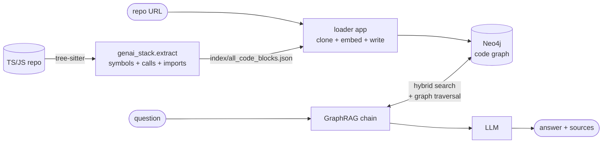
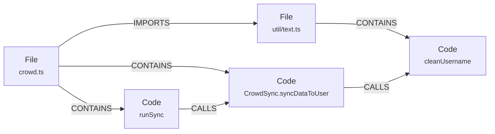
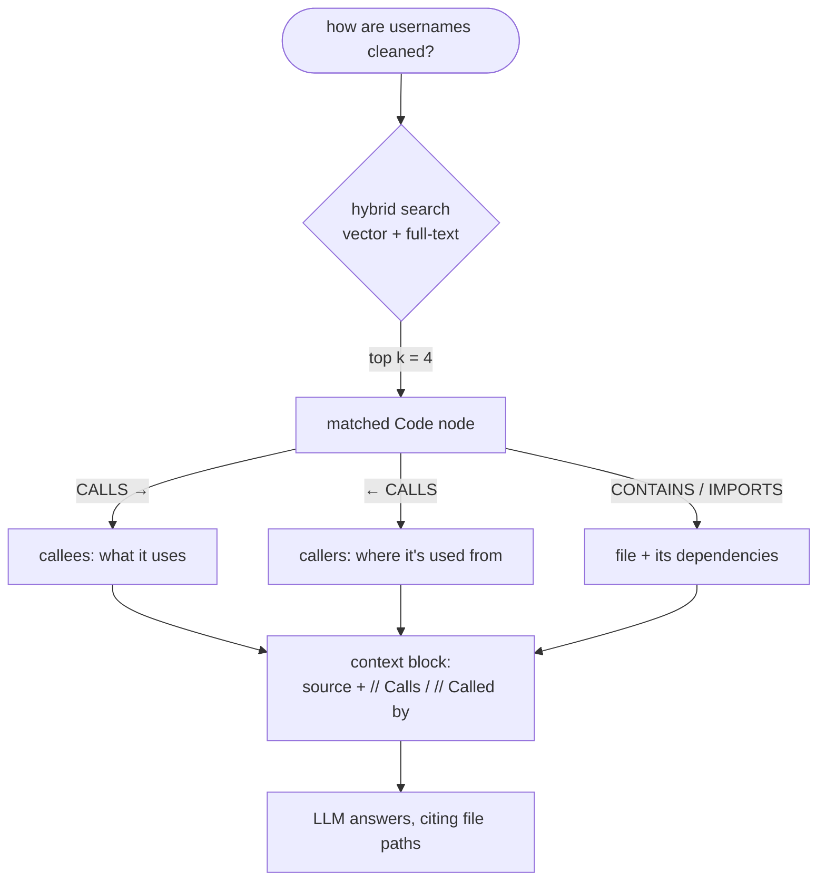

# GenAI Stack
This GenAI application stack will get you started building your
own GenAI application in no time.
The demo applications can serve as inspiration or as a starting point.
Learn more about the details in the [technical blog post](https://neo4j.com/developer-blog/genai-app-how-to-build/).

# How it works

A TS/JS repository is parsed into a code knowledge graph, and questions are
answered by searching that graph and then **walking its relationships** to pull
in code the question never matched directly.



## The graph

Each symbol is its own node, keyed by `path:line:qualified_name`, so a name that
repeats across the repo never collapses into one shared node.



`Code` nodes carry the symbol's source text plus its embedding, indexed by a
vector index and a full-text index.

## Retrieval

Vector search alone answers "which symbol looks like the question". The graph
answers "and what else do I need to understand it".



Full-text sits alongside vectors because code questions often name a symbol
exactly, which lexical matching handles better than embeddings.

## Layout

```
Dockerfile           one image, shared by all four Python services
genai_stack/         the library - no app code
  settings.py        environment configuration, read once
  extract.py         tree-sitter parsing of a repo into symbols and edges
  code_index.py      reshaping that index, resolving imports to files
  schema.py          Neo4j labels, constraints and indexes
  ingest.py          writing nodes and relationships into Neo4j
  retrieval.py       the graph traversal query and the vector store
  llm.py             loading chat and embedding models
  chains.py          the LLM-only and GraphRAG chains
apps/                thin entry points: api, bot, loader, pdf_bot
front-end/           Svelte client for the API
tests/               unit tests for the index pipeline
```

# Configure

Create a `.env` file from the environment template file `env.example`

Available variables:
| Variable Name          | Default value                      | Description                                                             |
|------------------------|------------------------------------|-------------------------------------------------------------------------|
| OLLAMA_BASE_URL        | http://host.docker.internal:11434  | REQUIRED - URL to Ollama LLM API                                        |   
| NEO4J_URI              | neo4j://database:7687              | REQUIRED - URL to Neo4j database                                        |
| NEO4J_USERNAME         | neo4j                              | REQUIRED - Username for Neo4j database                                  |
| NEO4J_PASSWORD         | password                           | REQUIRED - Password for Neo4j database                                  |
| LLM                    | qwen2.5-coder:1.5b                 | REQUIRED - Any Ollama model tag, or gpt-4, gpt-3.5, or claude (Bedrock) |
| EMBEDDING_MODEL        | sentence_transformer               | REQUIRED - Can be sentence_transformer, openai, aws or ollama           |
| AWS_ACCESS_KEY_ID      |                                    | REQUIRED - Only if LLM=claude or embedding_model=aws                    |
| AWS_SECRET_ACCESS_KEY  |                                    | REQUIRED - Only if LLM=claude or embedding_model=aws                    |
| AWS_DEFAULT_REGION     |                                    | REQUIRED - Only if LLM=claude or embedding_model=aws                    |
| OPENAI_API_KEY         |                                    | REQUIRED - Only if LLM=gpt-4 or LLM=gpt-3.5 or embedding_model=openai   |
| LANGCHAIN_ENDPOINT     | "https://api.smith.langchain.com"  | OPTIONAL - URL to Langchain Smith API                                   |
| LANGCHAIN_TRACING_V2   | false                              | OPTIONAL - Enable Langchain tracing v2                                  |
| LANGCHAIN_PROJECT      |                                    | OPTIONAL - Langchain project name                                       |
| LANGCHAIN_API_KEY      |                                    | OPTIONAL - Langchain API key                                            |
| CODE_INDEX_PATH        | index/all_code_blocks.json          | OPTIONAL - Index file the loader reads                                  |
| IMPORT_BATCH_SIZE      | 100                                | OPTIONAL - Symbols embedded and written per batch                       |
| API_KEY                |                                    | OPTIONAL - When set, the API requires it in the X-API-Key header        |
| ALLOWED_ORIGINS        | http://localhost:8505,...          | OPTIONAL - Comma separated CORS allowlist for the API                   |
| RATE_LIMIT_REQUESTS    | 30                                 | OPTIONAL - Requests per IP per window (0 disables)                      |
| RATE_LIMIT_WINDOW_SECONDS | 60                              | OPTIONAL - Rate limit window                                            |
| BEDROCK_MODEL_ID       | anthropic.claude-sonnet-5          | OPTIONAL - Bedrock model id used when LLM=claude                        |
| ALLOWED_GIT_HOSTS      | github.com,gitlab.com,bitbucket.org | OPTIONAL - Hosts the loader may clone from                             |

## LLM Configuration
MacOS and Linux users can use any LLM that's available via Ollama. Check the "tags" section under the model page you want to use on https://ollama.ai/library and write the tag for the value of the environment variable `LLM=` in th e`.env` file.
All platforms can use GPT-3.5-turbo and GPT-4 (bring your own API keys for OpenAIs models).

**MacOS**
Install [Ollama](https://ollama.ai) on MacOS and start it before running `docker compose up`.

**Linux**
No need to install Ollama manually, it will run in a container as
part of the stack when running with the Linux profile: run `docker compose --profile linux up`.
Make sure to set the `OLLAMA_BASE_URL=http://llm:11434` in the `.env` file when using Ollama docker container.

**Windows**
Not supported by Ollama, so Windows users need to generate a OpenAI API key and configure the stack to use `gpt-3.5` or `gpt-4` in the `.env` file.
# Develop

> [!WARNING]
> There is a performance issue that impacts python applications in the latest release of Docker Desktop. Until a fix is available, please use [version `4.23.0`](https://docs.docker.com/desktop/release-notes/#4230) or earlier.

**1. Set the model**

The default is `LLM=qwen2.5-coder:1.5b` — a code model small enough to run
comfortably on a laptop. Pick by the RAM you can spare:

| `LLM=` | Download | RAM while running | Notes |
|---|---|---|---|
| `qwen2.5-coder:1.5b` | ~1.0 GB | ~1.5 GB | Default. Code-specific, fine for this. |
| `qwen2.5-coder:7b` | ~4.7 GB | ~6 GB | Noticeably better answers if you have the room. |
| `llama3.2:3b` | ~2.0 GB | ~3 GB | General purpose. |
| `gpt-3.5` / `gpt-4` | none | none | Needs `OPENAI_API_KEY`; nothing is downloaded. |

`EMBEDDING_MODEL=sentence_transformer` runs locally and only costs ~90 MB.

Disk budget for the whole stack: ~2 GB app image, ~0.6 GB Neo4j, ~0.25 GB
front-end, plus the model if you run Ollama locally (~4.5 GB for the Ollama
image itself).

**2. Start everything**

```bash
docker compose up
```

On Linux this needs an LLM to talk to. Either run Ollama in a container:

```bash
docker compose --profile linux up
```

...with `OLLAMA_BASE_URL=http://llm:11434` in `.env`, or set `LLM=gpt-3.5` and
an `OPENAI_API_KEY` and nothing gets downloaded at all. Without one of these the
`pull-model` service fails and the app services wait on it forever.

**3. Index a repository**

Open the loader at http://localhost:8502, paste a public repository URL, and
press **Index repository**. It clones the repo, parses it, embeds every symbol
and builds the graph — no host-side step. `owner/repo` shorthand works too, and
a `/tree/<branch>` URL selects that branch.

> The repository is **cloned and parsed, never executed** — there is no install
> or build step, so no `postinstall` or other lifecycle script runs. Only
> public repos over `https://`, restricted to the hosts in `ALLOWED_GIT_HOSTS`.

When the import finishes the loader reports how many files, symbols, call edges
and import edges landed. **Cross-file call edges are the number to watch** —
they are what retrieval traverses to reach code a question does not name.

The import is idempotent: re-importing updates nodes in place rather than
duplicating them, and "Delete imported graph" under *Danger zone* clears it out.

### Indexing from the command line

The same pipeline runs headless, against a URL or a local checkout:

```bash
python3 -m genai_stack.extract --github-url sindresorhus/ky
```

```bash
python3 -m genai_stack.extract --repo ../Rocket.Chat
```

On the host this needs only the tree-sitter packages, not the full stack:

```bash
pip install tree-sitter tree-sitter-typescript tree-sitter-javascript
```

Useful flags: `--branch`, `--ignore-dir` / `--ignore-glob` to skip paths,
`--max-chars` to change where long symbols are truncated (the default of 4000
fits the retriever's `k=4` inside the model context), `--min-chars` to drop
trivial one-liners. The output lands in `index/`, which is mounted into the
loader container, so the *From an index file* tab can import it without a
rebuild.
If changes to build scripts has been made, **rebuild**.
```
docker compose up --build
```

To enter **watch mode** (auto rebuild on file changes).
First start everything, then in new terminal:
```
docker compose alpha watch
```

**Shutdown**
If health check fails or containers don't start up as expected, shutdown
completely to start up again.
```
docker compose down
```

**Run the tests**

```bash
pip install -r requirements-dev.txt && python3 -m pytest tests/
```

# Applications

Here's what's in this repo:

| Name | Main files | Compose name | URLs | Description |
|---|---|---|---|---|
| Support Bot | `apps/bot.py` | `bot` | http://localhost:8501 | Main usecase. Fullstack Python application. |
| Code Loader | `genai_stack/extract.py`, `apps/loader.py` | `loader` | http://localhost:8502 | Extract code symbols and relationships from a repo, then load them into the graph with embeddings. |
| PDF Reader | `apps/pdf_bot.py` | `pdf_bot` | http://localhost:8503 | Read local PDF and ask it questions. Fullstack Python application. |
| Standalone Bot API | `apps/api.py` | `api` | http://localhost:8504 | Standalone HTTP API streaming (SSE) + non-streaming endpoints. Python. |
| Standalone Bot UI | `front-end/` | `front-end` | http://localhost:8505 | Standalone client that uses the Standalone Bot API to interact with the model. JavaScript (Svelte) front-end. |

The database can be explored at http://localhost:7474.

## App 1 - Support Agent Bot

UI: http://localhost:8501
DB client: http://localhost:7474

- answer support question based on recent entries
- provide summarized answers with sources
- demonstrate difference between
    - RAG Disabled (pure LLM response)
    - RAG Enabled (vector + knowledge graph context)
- allow to generate a high quality support ticket for the current conversation based on the style of highly rated questions in the database.


*(Chat input + RAG mode selector)*

|  |  |
|---|---|
|  |  |
| *(CTA to auto generate support ticket draft)* | *(UI of the auto generated support ticket draft)* |

---

##  App 2 - Loader

UI: http://localhost:8502
DB client: http://localhost:7474

- paste a public repository URL and it clones, parses, embeds and builds the
  graph in one step
- or import an index file produced by `genai_stack.extract`
- builds the `(:File)-[:CONTAINS]->(:Code)` graph plus its `CALLS` and
  `IMPORTS` relationships
- embed each symbol and store the vector on the `Code` node, backed by a vector
  index and a full-text index for hybrid search
- UI: pick or upload an index, run the import, watch progress, clear the graph
  to re-import from scratch

The import is idempotent - symbols are keyed by `file path : line : qualified
name`, so re-running it updates nodes in place instead of duplicating them.


|  |  |
|---|---|
|  |  |

## App 3 Question / Answer with a local PDF
UI: http://localhost:8503  
DB client: http://localhost:7474

This application lets you load a local PDF into text
chunks and embed it into Neo4j so you can ask questions about
its contents and have the LLM answer them using vector similarity
search.


## App 4 Standalone HTTP API
Endpoints:
  - `POST /query` - non streaming, JSON body `{"text": "...", "rag": false}`
  - `POST /generate-ticket` - JSON body `{"text": "..."}`
  - `GET  /query-stream?text=hello&rag=false` - SSE streaming. This one stays a
    GET with query parameters because `EventSource` cannot issue POSTs.

Example cURL commands:
```bash
curl -X POST http://localhost:8504/query -H 'Content-Type: application/json' -d '{"text": "how is authentication handled", "rag": true}'
```

```bash
curl http://localhost:8504/query-stream\?text\=minimal%20hello%20world%20in%20python\&rag\=false
```

When `API_KEY` is set, send it as `-H "X-API-Key: ..."` (or `&api_key=...` on
the streaming endpoint). Requests are rate limited per client IP; see
`RATE_LIMIT_REQUESTS`.

Exposes the functionality to answer questions in the same way as App 1 above. Uses
same code and prompts.

## App 5 Static front-end
UI: http://localhost:8505

This application has the same features as App 1, but is built separate from
the back-end code using modern best practices (Vite, Svelte, Tailwind).  
The auto-reload on changes are instant using the Docker watch `sync` config.  

