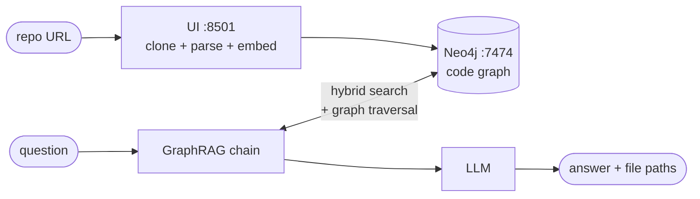
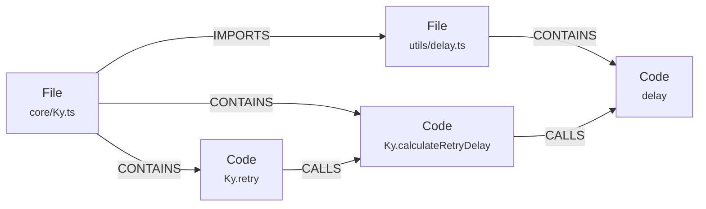
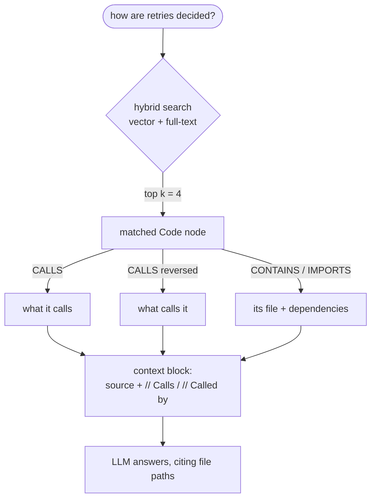

# Code graph RAG

Point it at a TypeScript/JavaScript repository and ask questions about it.

The repo is parsed into a **knowledge graph** in Neo4j — every function, method,
class and type is a node, with edges for what calls what and which files import
which. Answering a question searches that graph *and walks its relationships*,
so the model sees the code you asked about **plus the code around it**.

---

## How it works



### The graph

Every symbol is its own node keyed by `path:line:qualified_name`, so a name that
repeats across the repo never collapses into one shared node.



### Retrieval

Vector search finds an entry point. The graph supplies the context around it —
that traversal is what makes this GraphRAG rather than vector search that
happens to be stored in a graph.



Full-text sits alongside vectors because code questions often name a symbol
exactly, which lexical matching handles better than embeddings.

---

## Quick start

**1.** Copy `env.example` to `.env`. The defaults work; the one choice that
matters is the model.

**2.** Start it:

```bash
docker compose up
```

Answering questions needs an LLM. On Linux, run one in a container:

```bash
docker compose --profile linux up
```

...with `OLLAMA_BASE_URL=http://llm:11434` in `.env`. Or set `LLM=gpt-3.5` plus
an `OPENAI_API_KEY` and nothing is downloaded. Without either, indexing still
works and questions report a clear error.

**3.** Open **http://localhost:8501**, paste a repository URL on *Index a
repository*, and press the button. Then ask questions on *Ask the codebase*.

The importer is idempotent — re-indexing updates nodes in place.

---

## What runs where

| URL | Service | What it is |
|---|---|---|
| **http://localhost:8501** | `ui` | The app. Three pages: index a repository, ask the codebase, chat with a PDF. |
| http://localhost:7474 | `database` | Neo4j browser — inspect the graph directly. neo4j / password. |
| http://localhost:8504 | `api` | HTTP API over the same chains, for scripting or your own front-end. |

Two optional extras, off by default:

```bash
docker compose --profile linux up      # + Ollama at :11434
docker compose --profile frontend up   # + a Svelte client at :8505
```

## Where is what

```
Dockerfile              one image, shared by every Python service
docker-compose.yml      four services by default: ui, api, database, pull-model

genai_stack/            the library — no UI, no app code
  settings.py           environment configuration, read once
  extract.py            tree-sitter parsing: symbols, calls, imports
  code_index.py         reshaping the index, resolving imports to files
  schema.py             Neo4j labels, constraints, indexes
  ingest.py             writing nodes and relationships
  retrieval.py          the graph traversal query + vector store
  llm.py                loading chat and embedding models
  chains.py             the LLM-only and GraphRAG chains
  sources.py            validating and cloning repository URLs

apps/                   thin entry points over the library
  ui.py                 the Streamlit app (page router)
  resources.py          cached model/database handles, shared by all pages
  page_index.py         "Index a repository"
  page_chat.py          "Ask the codebase"
  page_pdf.py           "Chat with a PDF"
  api.py                the FastAPI service

front-end/              optional Svelte client for the API
tests/                  tests over the index pipeline
index/                  generated code indexes (gitignored)
data/                   Neo4j's database volume (gitignored)
```

---

## Configuration

Everything is optional except the model choice. Full list in `env.example`.

| Variable | Default | Notes |
|---|---|---|
| `LLM` | `qwen2.5-coder:1.5b` | Any Ollama tag, or `gpt-4`, `gpt-3.5`, `claude` |
| `EMBEDDING_MODEL` | `sentence_transformer` | Or `openai`, `aws`, `ollama` |
| `OLLAMA_BASE_URL` | `http://host.docker.internal:11434` | `http://llm:11434` with the linux profile |
| `NEO4J_URI` / `_USERNAME` / `_PASSWORD` | `neo4j://database:7687` / `neo4j` / `password` | |
| `OPENAI_API_KEY` | | Only for `gpt-*` or `EMBEDDING_MODEL=openai` |
| `AWS_*`, `BEDROCK_MODEL_ID` | `anthropic.claude-sonnet-5` | Only for `LLM=claude` or `EMBEDDING_MODEL=aws` |
| `CODE_INDEX_PATH` | `index/all_code_blocks.json` | Where the UI reads and writes indexes |
| `IMPORT_BATCH_SIZE` | `100` | Symbols embedded and written per batch |
| `ALLOWED_GIT_HOSTS` | `github.com,gitlab.com,bitbucket.org` | Hosts the UI may clone from |
| `API_KEY` | *(empty = no auth)* | When set, required as `X-API-Key` |
| `ALLOWED_ORIGINS` | `http://localhost:8505,...` | CORS allowlist for the API |
| `RATE_LIMIT_REQUESTS` / `_WINDOW_SECONDS` | `30` / `60` | Per client IP; `0` disables |

### Choosing a model

| `LLM=` | Download | RAM in use | Notes |
|---|---|---|---|
| `qwen2.5-coder:1.5b` | ~1.0 GB | ~1.5 GB | Default. Code-specific. |
| `qwen2.5-coder:7b` | ~4.7 GB | ~6 GB | Better answers if you have the room. |
| `llama3.2:3b` | ~2.0 GB | ~3 GB | General purpose. |
| `gpt-3.5` / `gpt-4` | none | none | Needs `OPENAI_API_KEY`. |

Disk for the whole stack: ~2 GB app image, ~0.6 GB Neo4j, plus ~4.5 GB if you
run Ollama in a container.

---

## The HTTP API

| Endpoint | Body |
|---|---|
| `POST /query` | `{"text": "...", "rag": true}` |
| `POST /generate-ticket` | `{"text": "..."}` |
| `GET /query-stream?text=…&rag=true` | SSE. Stays a GET because `EventSource` cannot POST. |

```bash
curl -X POST http://localhost:8504/query -H 'Content-Type: application/json' \
  -d '{"text": "how are retries decided?", "rag": true}'
```

With `API_KEY` set, send `-H "X-API-Key: …"` (or `&api_key=…` on the stream).

---

## Indexing from the command line

The UI and the CLI share one code path:

```bash
python3 -m genai_stack.extract --github-url sindresorhus/ky
```

```bash
python3 -m genai_stack.extract --repo ../some-local-checkout
```

On the host this needs only tree-sitter, not the full stack:

```bash
pip install tree-sitter tree-sitter-typescript tree-sitter-javascript
```

Flags: `--branch`, `--ignore-dir` / `--ignore-glob`, `--max-chars` (where long
symbols are truncated; the 4000 default fits the retriever's `k=4` inside the
model context), `--min-chars`. Output lands in `index/`, which is mounted into
the UI container, so the *From an index file* tab can import it.

> Repositories are **cloned and parsed, never executed** — no install or build
> step runs. Public repos over `https://` only, restricted to
> `ALLOWED_GIT_HOSTS`.

---

## Tests

```bash
pip install -r requirements-dev.txt && python3 -m pytest tests/
```

Covers symbol extraction, call and import resolution, URL validation and index
reshaping. No database and no LLM needed.

---

## Known limits

- **TypeScript and JavaScript only** (`.ts`, `.tsx`, `.js`, `.jsx`, `.mjs`,
  `.cjs`). Other languages produce an empty index.
- **Call edges are resolved by name**, preferring a definition in the same file
  and otherwise requiring the name to be unique in the repo. Ambiguous names are
  left unlinked rather than linked incorrectly.
- **Dynamic dispatch is invisible** — `handlers[key]()` produces no edge.
- **Interfaces and enums are stored as member skeletons**, without their doc
  comments. Full JSDoc bodies used to dominate semantic search over the code
  that implements the behaviour being asked about.
- The PDF page is unrelated to the code graph; it stores chunks under its own
  `PdfBotChunk` label.

---

Originally a fork of [neo4j-labs/genai-stack](https://github.com/docker/genai-stack),
rebuilt around a code knowledge graph.
